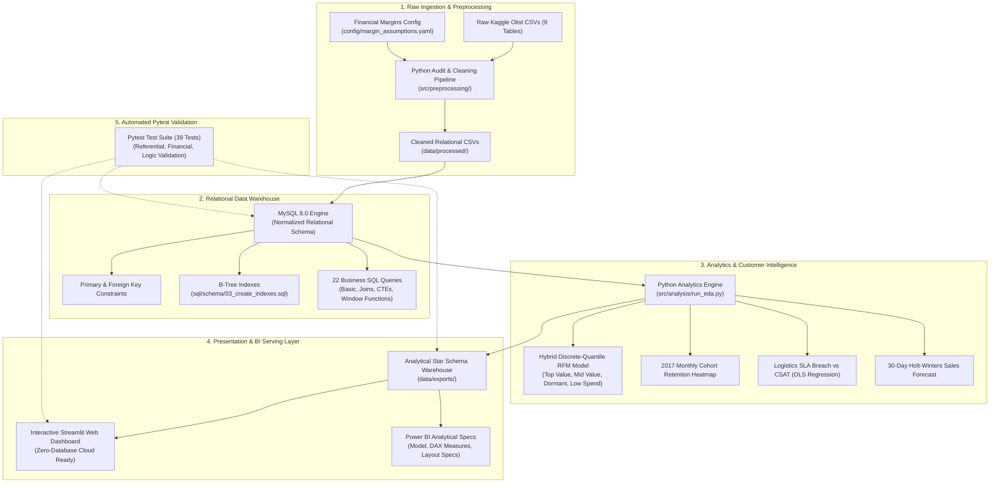
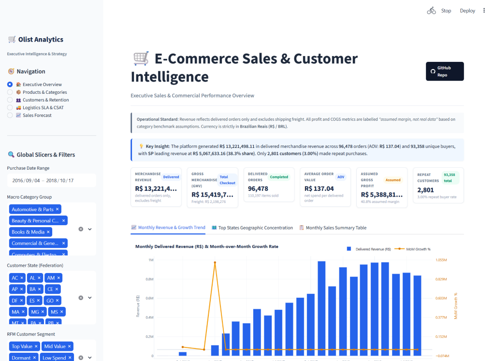
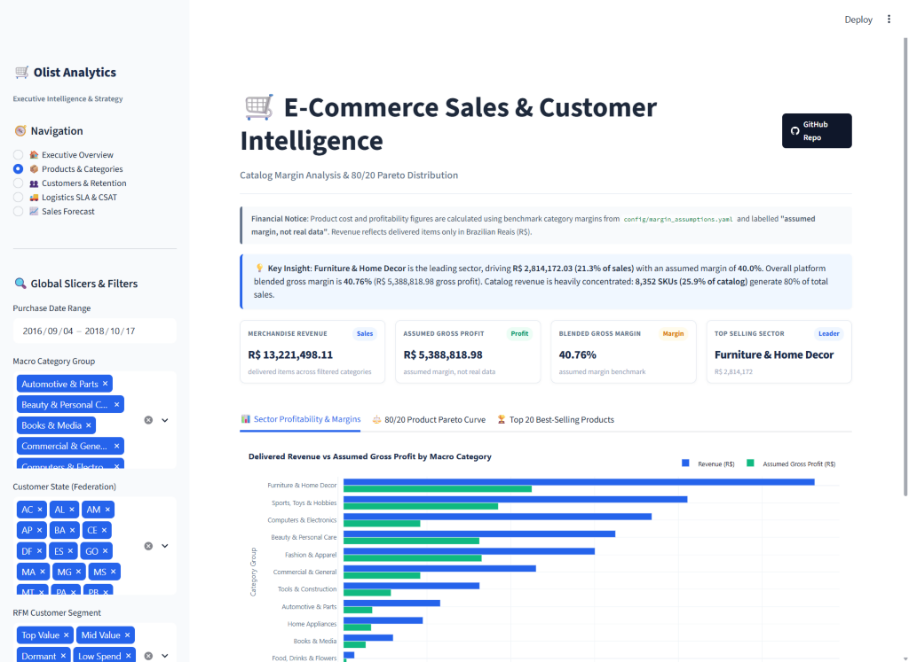
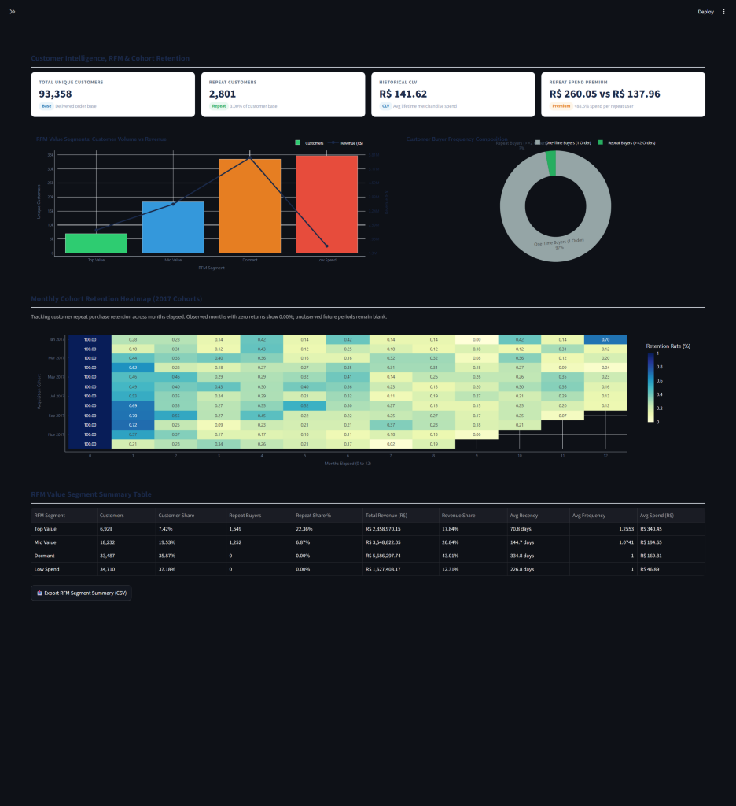
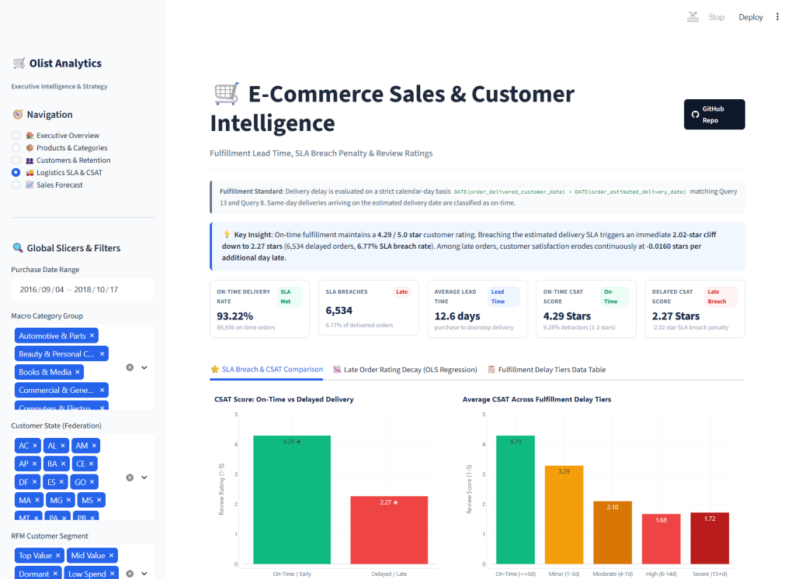
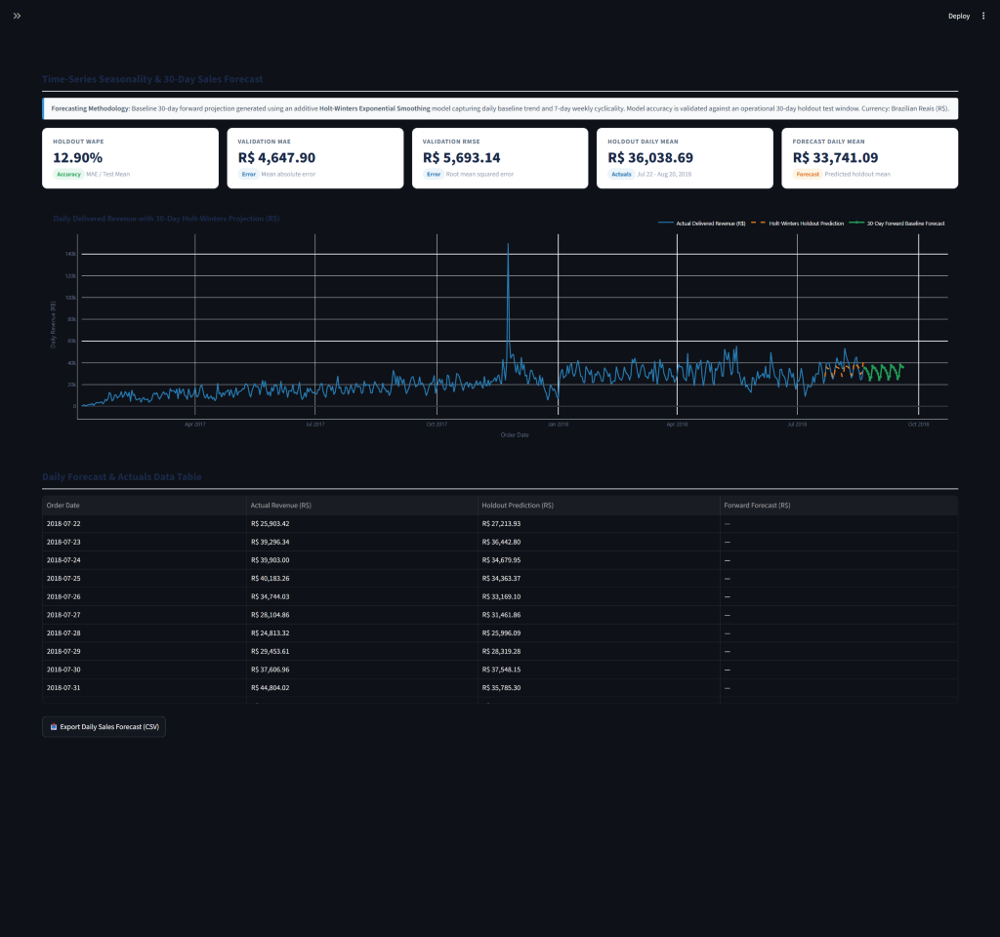
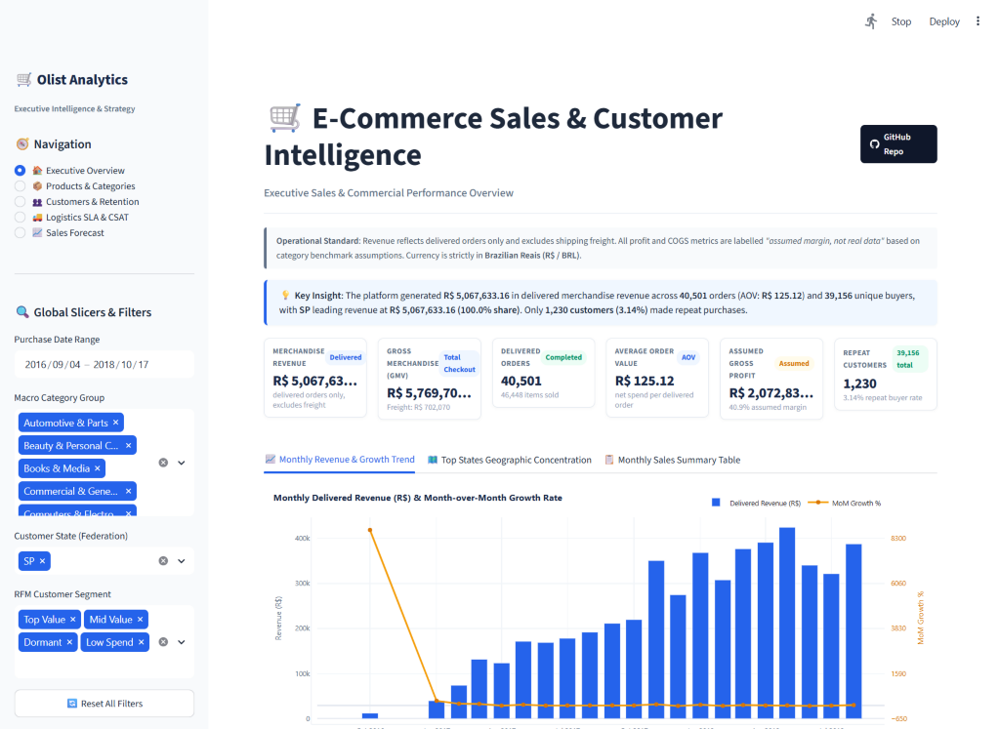

# E-Commerce Sales & Customer Intelligence Analytics Platform

**Live demo**: link coming after deployment

An end-to-end data analytics and customer intelligence platform built on the **Olist Brazilian E-Commerce** ecosystem (~100k orders, 2016–2018).

> **Currency Specification**: All monetary values across this platform are denominated strictly in **Brazilian Reais (R$ / BRL)**.  
> **Revenue Definition**: Revenue refers strictly to delivered transactions (`order_status = 'delivered'`) and excludes shipping freight charges, unless explicitly designated as Gross Merchandise Value (GMV).  
> **Profitability Notice**: The raw dataset contains no supplier invoice or cost data; all Cost of Goods Sold (COGS) and gross margins are retail benchmark assumptions documented in `config/margin_assumptions.yaml` (*assumed margin, not real data*).

---

## 1. Architecture Overview



---

## 2. Repository Directory Structure

```text
├── config/
│   └── margin_assumptions.yaml        # Documented category financial proxies in BRL (R$) (assumption, not real data)
├── data/
│   ├── raw/                           # Original Kaggle Olist CSVs (git-ignored)
│   ├── processed/                     # Cleaned relational CSVs ready for DB ingestion (git-ignored)
│   └── exports/                       # Analytical Star Schema CSVs & model outputs (tracked for cloud deployment)
├── docs/
│   ├── data_dictionary.md             # Complete relational & star schema data dictionary
│   ├── eda_findings.md                # In-depth statistical analysis, RFM, cohorts, and logistics report
│   ├── sql_results.md                 # 22 business SQL queries with results and business insights
│   ├── career_pack.md                 # Resume bullets, LinkedIn post, and 15 technical interview Q&As
│   └── screenshots/                   # High-resolution dashboard and visualization captures
├── power_bi/
│   ├── data_model_spec.md             # Star Schema relationships, cardinalities, and storage settings
│   ├── dax_measures.md                # 34 production DAX formulas (Time Intelligence, Slicing, CSAT)
│   └── dashboard_layout_spec.md       # Visual hierarchy, KPI cards, and canvas layout blueprint
├── sql/
│   ├── schema/                        # DDL table creation and index scripts
│   │   ├── 01_create_database.sql
│   │   ├── 02_create_tables.sql
│   │   └── 03_create_indexes.sql
│   └── queries/                       # 22 business SQL queries organized by difficulty tier
│       ├── all_business_queries.sql
│       ├── tier1_basic_aggregations.sql
│       ├── tier2_joins_grouping.sql
│       ├── tier3_subqueries_ctes.sql
│       └── tier4_window_functions_advanced.sql
├── src/
│   ├── config.py                      # Environment and margin assumption loader
│   ├── preprocessing/                 # Raw data audit and cleaning pipeline
│   ├── database/                      # MySQL connection manager and transactional batch loader
│   └── analysis/                      # Advanced analytics (RFM, Cohort, CLV, Forecast, Power BI Exporter)
├── streamlit_app/                     # Interactive Streamlit executive web application
│   ├── app.py                         # Application entrypoint and URL query router
│   ├── kpi_metrics.py                 # Pure-Python KPI evaluation and filtering engine
│   ├── data_loader.py                 # Relative path cached CSV loader (@st.cache_data)
│   ├── components.py                  # Custom CSS styling and HTML KPI cards
│   └── views/                         # 5 report view modules (Overview, Products, Customers, Delivery, Forecast)
├── tests/                             # Pytest automated test suite (39 passing tests)
├── requirements.txt                   # Production pinned dependencies
├── .env.example                       # Secure environment configuration template
└── README.md                          # Platform master documentation
```

---

## 3. Technology Stack

| Domain | Technologies & Libraries | Purpose |
| :--- | :--- | :--- |
| **Relational Database** | **MySQL 8.0**, MySQL Workbench | Normalized relational operational warehouse, foreign keys, indexes, stored queries |
| **Programming Language** | **Python 3.10 / 3.11** | Core data pipelines, statistical modeling, analytical calculations |
| **Data Manipulation** | **Pandas, NumPy** | In-memory transformations, vectorization, aggregation |
| **Statistical & ML Modeling** | **Statsmodels, SciPy** | OLS regression (CSAT decay via SciPy stats), Holt-Winters Exponential Smoothing |
| **Data Visualization** | **Plotly, Matplotlib, Seaborn** | Interactive UI charts, publication-ready statistical plots |
| **Web Application** | **Streamlit** (v1.65.0) | Multi-page executive dashboard with zero-database cloud architecture |
| **Business Intelligence** | **Power BI Desktop** (Specification) | Star Schema data model, 34 DAX measures, executive layout specs |
| **Quality Assurance** | **Pytest** | 39 automated tests validating referential integrity and financial balance |
| **Version Control** | **Git, GitHub** | Source tracking, semantic commits, cloud deployment trigger |

---

## 4. Key Findings & Empirical Metrics

Every metric below is extracted directly from script executions and project logs.

| Metric | Empirical Value | Sourced Document & Reference | Key Business Insight |
| :--- | :---: | :--- | :--- |
| **Delivered Merchandise Revenue** | **R$ 13,221,498.11** | `docs/sql_results.md` (Query 1); `docs/eda_findings.md` | Net delivered merchandise spend across platform (excludes freight). |
| **Gross Merchandise Value (GMV)** | **R$ 15,419,773.75** | `docs/sql_results.md` (Query 1) | Merchandise sales + R$ 2,198,275.64 logistics freight. |
| **Total Delivered Orders** | **96,478** | `docs/sql_results.md` (Query 1) | Completed orders (out of 99,441 total recorded order attempts). |
| **Total Unique Customers** | **93,358** | `docs/eda_findings.md` (Executive Summary) | Distinct individuals tracked via `customer_unique_id`. |
| **Repeat Customer Count** | **2,801 (3.00%)** | `docs/eda_findings.md` (Section 1); `docs/sql_results.md` (Query 11) | Only 3.00% of customers purchase $\ge 2$ times (97.00% buy once). |
| **Average Order Value (AOV)** | **R$ 137.04** | `docs/sql_results.md` (Query 1) | Average net basket value per delivered order. |
| **Historical CLV (All Customers)** | **R$ 141.62** | `docs/eda_findings.md` (Section 3) | Average cumulative merchandise spend per unique customer. |
| **Repeat Buyer CLV Premium** | **R$ 260.05 vs R$ 137.96** | `docs/eda_findings.md` (Section 3) | Repeat buyers generate **+88.5% higher lifetime value** than one-time buyers. |
| **Top Value RFM Contribution** | **17.84% (R$ 2,358,970.15)** | `docs/eda_findings.md` (Section 1); `data/exports/rfm_segment_summary.csv` | 6,929 high-value customers (7.42% of base) spend an average of R$ 340.45. |
| **Month-1 Cohort Retention** | **0.47%** | `docs/eda_findings.md` (Section 2); `data/exports/cohort_retention_matrix.csv` | Severe customer churn: average month-1 repurchase rate is under 0.5%. |
| **Product Pareto Concentration** | **25.93% (8,352 SKUs)** | `docs/eda_findings.md` (Section 4); `data/exports/pareto_product_summary.csv` | 25.93% of unique catalog products account for 80% of merchandise sales. |
| **On-Time vs Late CSAT Score** | **4.29 vs 2.27 stars** | `docs/sql_results.md` (Query 8); `docs/eda_findings.md` (Section 5) | Immediate **2.02-star drop** when delivery breaches estimated SLA date. |
| **Late CSAT Degradation Slope** | **-0.0160 stars / day** | `docs/eda_findings.md` (Section 5) | OLS regression on late orders reveals steady rating erosion per day delayed. |
| **Assumed Gross Margin** | **40.76% (R$ 5,388,818.98)** | `docs/sql_results.md` (Query 14) | Blended margin contribution across 11 sectors (*assumed margin, not real data*). |
| **Forecast Holdout Accuracy** | **12.90% WAPE** | `docs/eda_findings.md` (Section 7) | 30-day Holt-Winters holdout test error (MAE: R$ 4,647.90 vs mean R$ 36,038.69). |

---

## 5. Key Recommendations

Based on empirical data across the SQL warehouse and Python analytics pipelines, we prioritize four strategic business recommendations:

1. **Mitigate Fulfillment SLA Breaches to Protect Brand Equity**:  
   - **Data & Source**: On-time deliveries maintain an average CSAT of **4.29 stars** (89,944 reviews), whereas late deliveries suffer an immediate **2.02-star cliff down to 2.27 stars** (6,409 reviews with 62.41% 1–2 star detractors; `docs/sql_results.md` Query 8; `docs/eda_findings.md` Section 5). CSAT continues to erode at **-0.0160 stars per additional day late** via late-order OLS regression (`docs/eda_findings.md` Section 5). Overall, **6,534 delivered orders (6.77% of 96,470 evaluated orders)** breached their carrier estimated delivery date (`docs/sql_results.md` Query 13).  
   - **Action**: Dynamically extend customer-facing delivery estimates by +2 business days on long-haul transit corridors to eliminate minor 1–3 day SLA breaches (1,870 orders; `docs/sql_results.md` Query 13), and deploy automated Day-1 breach notifications with R$ 15 freight credits to reduce detractor review submission.

2. **Drive Targeted Re-Engagement Campaigns to Capture the Repeat Buyer CLV Premium**:  
   - **Data & Source**: Only **3.00% of customers (2,801 individuals)** purchase $\ge 2$ times, yet repeat customers generate an **+88.5% CLV premium** (**R$ 260.05 vs R$ 137.96**; `docs/sql_results.md` Query 11; `docs/eda_findings.md` Section 3). The average purchase latency between successive repeat orders is **79.10 days** across 3,120 reorder events (`docs/sql_results.md` Query 20). The **6,929 Top Value** RFM segment currently drives **17.84% (R$ 2,358,970.15)** of total merchandise revenue with an average spend of **R$ 340.45** (`docs/eda_findings.md` Section 1; `data/exports/rfm_segment_summary.csv`).  
   - **Action**: Implement automated post-purchase email and SMS re-engagement sequences timed at days 60–80 (preceding the 79.10-day reorder cycle) targeting Top Value buyers with personalized recommendations to cultivate repeat purchasing.

3. **Expand High-Margin Consumable Categories to Offset Durable Churn**:  
   - **Data & Source**: Average Month-1 repurchase retention is only **0.47%** across 2017 monthly cohorts (`docs/eda_findings.md` Section 2; `data/exports/cohort_retention_matrix.csv`), reflecting marketplace reliance on one-time durable goods. The top individual product category, `health_beauty`, generates **R$ 1,233,131.72** across 9,465 sold units (`docs/sql_results.md` Query 6), and the broader `Beauty & Personal Care` macro sector yields **R$ 1,624,777.16** in revenue and **R$ 812,388.58** in gross profit at a **50.00% assumed gross margin** (`docs/sql_results.md` Query 14; `config/margin_assumptions.yaml`).  
   - **Action**: Incentivize onboarding of consumable and replenishment merchants across personal care, beauty, and pet supplies with reduced platform take-rates to build high-frequency replenishment habits.

4. **Restructure Logistics Subsidies for High-Freight Bulky Sectors**:  
   - **Data & Source**: Across all delivered orders, logistics freight averages **16.63% of merchandise price** (**R$ 2,198,275.64 freight** on **R$ 13,221,498.11 item revenue**; `docs/sql_results.md` Query 1; representing **14.26% of GMV** R$ 15,419,773.75). The freight-to-price ratio surges significantly above platform average in heavy/bulky sectors: **22.17% (R$ 623,981.57 freight)** in Furniture & Home Decor and **18.31% (R$ 148,977.54 freight)** in Tools & Construction (`docs/sql_results.md` Query 9).  
   - **Action**: Negotiate contracted volume freight discounts with regional carriers and introduce tiered free-shipping thresholds above R$ 200 on bulky goods to reduce checkout cart abandonment where shipping costs exceed 20% of item price.

---

## 6. Interactive Streamlit Web Application

The interactive web dashboard is located in `streamlit_app/`. It reads exclusively from pre-aggregated analytical Star Schema CSVs in `data/exports/` using `@st.cache_data`.

### Live Application Views

#### 1. Executive Sales Performance Overview
Displays high-level KPI cards, dual-axis monthly revenue and MoM growth trajectories, top 10 customer states, and exportable monthly sales tables.


#### 2. Products & Macro Category Profitability
Evaluates macro sector gross profit margins (*assumed margin, not real data*), product catalog 80/20 Pareto revenue distribution, and SKU-level bestsellers.


#### 3. Customer Intelligence, RFM & Cohort Retention
Visualizes customer volume vs revenue across the 4 hybrid RFM segments, repeat buyer donut breakdown, and the 2017 monthly cohort retention heatmap.


#### 4. Logistics Fulfillment SLA & Customer Satisfaction (CSAT)
Compares on-time (4.29 stars) vs late (2.27 stars) review ratings, breaks down satisfaction across 5 delivery delay tiers, and plots the late-order OLS rating decay slope.


#### 5. Time-Series Seasonality & 30-Day Sales Forecast
Presents the 30-day forward Holt-Winters Exponential Smoothing projection, holdout test validation actuals vs predictions, and daily statistical data tables.


#### 6. Reactive Multi-Dimensional Filtering Example (State = SP)
Demonstrates reactive dashboard recalculation when filtered by Customer State = SP (delivering 40,501 orders and R$ 5,067,633.16 in merchandise revenue).


---

## 7. Power BI: Data Model, DAX Measures & Layout Specification

> **Implementation Note**: The Power BI project assets are fully designed and documented as architectural blueprints. All data modeling relationships, DAX formulas, and layout specifications are completed in `power_bi/`. A fully assembled `.pbix` file can be authored in Power BI Desktop by importing `data/exports/` and pasting the DAX measures.

- **Data Model Specification**: [power_bi/data_model_spec.md](power_bi/data_model_spec.md) (Star Schema relationships, cardinalities, cross-filtering, and column definitions).
- **DAX Formula Repository**: [power_bi/dax_measures.md](power_bi/dax_measures.md) (34 production DAX measures covering revenue, margins, repeat loyalty, and SLA metrics).
- **Executive Layout Blueprint**: [power_bi/dashboard_layout_spec.md](power_bi/dashboard_layout_spec.md) (Canvas sizing, visual formatting, color hex codes, and 4-page report design).

---

## 8. Setup & Execution Guide

### 8.1 Prerequisites
- **Operating System**: Windows 10/11, macOS, or Linux.
- **Python**: Version 3.10 or 3.11 installed.
- **MySQL Server**: Local MySQL 8.0 running on port 3306.

### 8.2 Environment Setup
1. Clone the repository:
   ```powershell
   git clone https://github.com/Samk709/ecommerce-sales-customer-analytics.git
   cd ecommerce-sales-customer-analytics
   ```

2. Create and activate a Python virtual environment:
   ```powershell
   # Windows PowerShell:
   python -m venv venv
   .\venv\Scripts\Activate.ps1
   ```

3. Install required production dependencies:
   ```powershell
   pip install -r requirements.txt
   ```

4. Configure local environment variables:
   Copy `.env.example` to `.env` and enter your local MySQL password:
   ```env
   DB_HOST=localhost
   DB_PORT=3306
   DB_USER=root
   DB_PASSWORD=your_actual_password_here
   DB_NAME=olist_ecommerce
   ```
   *(Never commit `.env` to Git; it is strictly excluded in `.gitignore`).*

### 8.3 Database Setup & Data Ingestion
1. Place the 9 Kaggle Olist CSV files into `data/raw/`.
2. Run data audit and cleaning pipelines:
   ```powershell
   python -m src.preprocessing.audit
   python -m src.preprocessing.clean_data
   ```
3. Create database schema and populate MySQL 8.0:
   ```powershell
   python -m src.database.load_data
   ```
4. Verify database row counts match processed source files:
   ```powershell
   python -m src.database.verify_db
   ```

### 8.4 Running Analytics & Exporting Star Schema
Execute the statistical analytics engine to generate RFM segments, cohort retention matrices, forecast models, and Power BI Star Schema tables:
```powershell
python -m src.analysis.run_eda
python -m src.analysis.export_powerbi_data
```

### 8.5 Launching the Streamlit Web Application
Run the interactive Streamlit dashboard locally:
```powershell
streamlit run streamlit_app/app.py
```
Open your browser to `http://localhost:8501`.

---

## 9. Free Cloud Deployment (Streamlit Community Cloud)

The Streamlit web application is engineered for zero-database deployment. All data access in `streamlit_app/data_loader.py` resolves relative to `__file__`, and all dependencies are pinned in root `requirements.txt`.

### Step-by-Step Deployment Instructions:
1. Ensure your latest changes are pushed to your public GitHub repository (`main` branch).
2. Navigate to [share.streamlit.io](https://share.streamlit.io) and sign in using your GitHub account.
3. Click the **"New app"** button.
4. Fill in the deployment form:
   - **Repository**: `Samk709/ecommerce-sales-customer-analytics`
   - **Branch**: `main`
   - **Main file path**: `streamlit_app/app.py`
5. Click **"Deploy!"**.
6. Streamlit Community Cloud will automatically install dependencies from `requirements.txt`, launch the container, and provide a permanent public HTTPS URL.

> **Note on Filter Scope for Forecast & Cohort Views**:  
> In the Streamlit app, the **Sales Forecast** and **Cohort Retention Heatmap** views model platform-wide dynamics. The Holt-Winters model captures daily platform aggregate demand to preserve 7-day cyclical seasonality without sample fragmentation. Similarly, monthly cohort retention evaluates platform customer lifecycle retention across 2017. As designed, these two views remain fixed to platform-level totals rather than slicing by state or category sub-filters.

---

## 10. Automated Testing & Quality Assurance

A comprehensive test suite containing **39 automated unit tests** validates end-to-end data quality, database constraints, business queries, and financial balances:

```powershell
pytest -v tests
```

### Test Suite Structure:
- `tests/test_data_quality.py`: Primary key uniqueness, non-null integrity, price/freight non-negativity, and coordinate bounds (5 tests).
- `tests/test_db_connection.py`: MySQL connectivity and schema table presence (2 tests).
- `tests/test_sql_queries.py`: Financial reconciliations, status totals, SLA tier reconciliations, and review score sums (11 tests).
- `tests/test_eda.py`: RFM customer and revenue balances, cohort bounds, Pareto distributions, and holdout WAPE validation (7 tests).
- `tests/test_powerbi_exports.py`: Star Schema row counts, referential integrity, and financial totals (5 tests).
- `tests/test_streamlit_kpis.py`: Standalone verification that unfiltered baseline KPIs match exact platform numbers (3 tests).
- `tests/test_readme_reconciliation.py`: End-to-end validation of all published headline numbers and claims against exported data (6 tests).

---

## 11. Platform Limitations & Ethical Considerations

1. **Absence of Real Cost / Wholesale Acquisition Data**:  
   The raw Olist dataset contains transactional prices and logistics freight charges, but zero supplier invoice, wholesale product cost, or merchant commission data. To model profitability, we established retail margin benchmark proxies in `config/margin_assumptions.yaml` grouped into 11 macro categories. All profit and COGS metrics are explicitly labelled **"assumed margin, not real data"**.
2. **Fixed Historical Time Horizon (2016–2018)**:  
   The dataset covers customer orders from September 2016 through October 2018. Economic conditions, consumer behaviors, and delivery infrastructure in Brazil have evolved significantly since 2018.
3. **High Single-Purchase Concentration (97.00%)**:  
   97.00% of customers completed exactly one order during the 2-year window. While this may reflect an e-commerce marketplace specializing in durable goods (appliances, furniture, electronics), retention and repeat purchase analyses must be interpreted with this structural acquisition skew in mind.

---

## 12. Project Documentation Index

- **Data Dictionary**: [docs/data_dictionary.md](docs/data_dictionary.md) (Complete field definitions, relational keys, and Star Schema tables).
- **Statistical EDA & Customer Intelligence**: [docs/eda_findings.md](docs/eda_findings.md) (Full analytical report covering RFM, cohorts, Pareto, and logistics).
- **Business SQL Query Catalog**: [docs/sql_results.md](docs/sql_results.md) (22 queries with SQL syntax, MySQL results, and business takeaways).
- **Career & Interview Preparation Pack**: [docs/career_pack.md](docs/career_pack.md) (Resume bullets with sources, LinkedIn launch post, and 15 technical interview Q&As).
