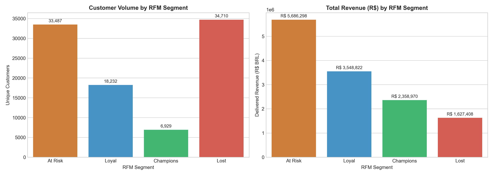
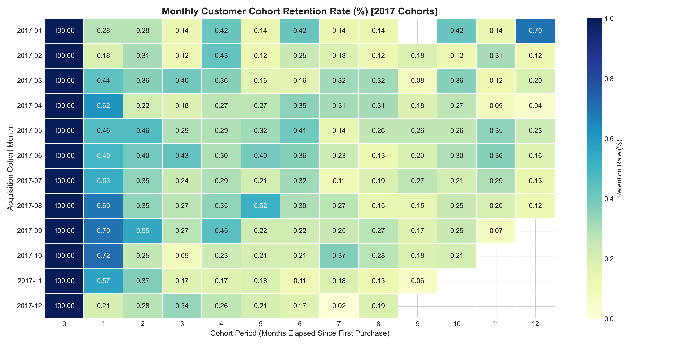
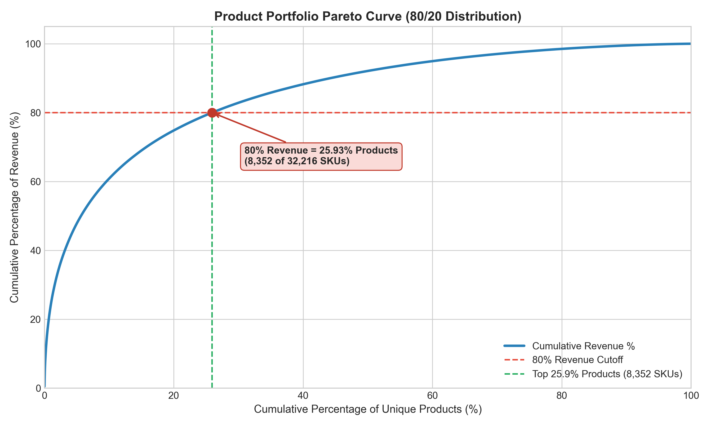
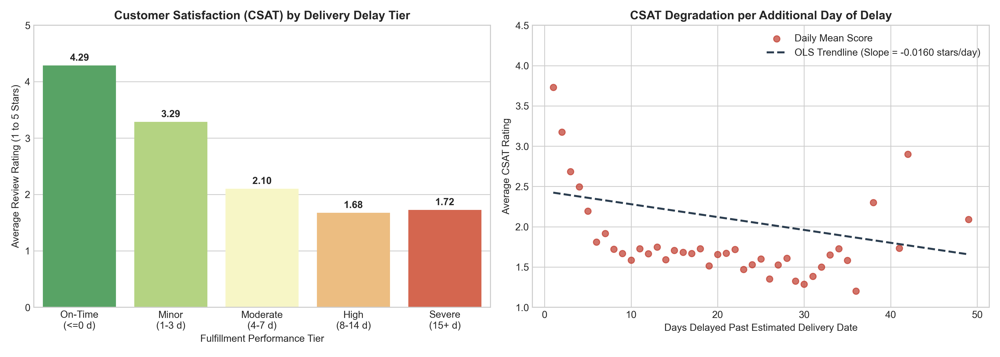
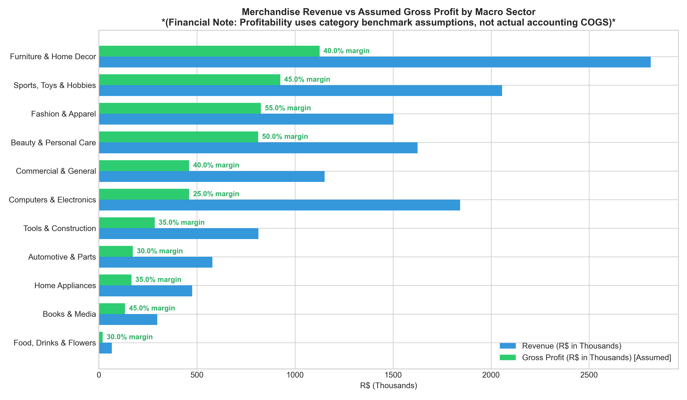
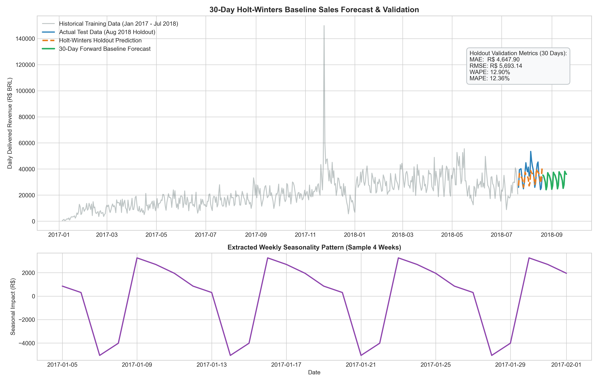

# Phase 4: Exploratory Data Analysis (EDA) & Customer Intelligence
> **Currency Standard**: All monetary figures are reported strictly in **Brazilian Reais (R$ / BRL)**.
> **Operational Filter**: All calculations filter strictly for delivered transactions (`order_status = 'delivered'`) and exclude shipping freight, unless explicitly stated.
> **Profitability Notice**: All profit and COGS figures are labelled **"assumed margin, not real data"** based on category benchmark assumptions.

## Executive Summary: Headline Findings

| Metric | Value | Business Context |
|:---|---:|:---|
| **Total Unique Customers** | **93,358** | Platform customer base across delivered orders |
| **Total Merchandise Revenue** | **R$ 13,221,498.11** | Platform delivered item GMV (excludes freight) |
| **Overall Historical CLV** | **R$ 141.62** | Average lifetime spend per unique customer |
| **Margin-Adjusted Historical CLV** | **R$ 57.72** | Average gross profit contribution per customer *(Assumed)* |
| **Repeat Buyer CLV Premium** | **R$ 260.05 vs R$ 137.96** | Repeat customers spend **+88.5%** more than one-time buyers |
| **Month 1 Cohort Retention** | **0.47%** | Platform-wide average repeat retention in month 1 |
| **Product Pareto Concentration** | **25.93% (8,352 SKUs)** | Proportion of products generating 80% of revenue |
| **Delay Rating Degradation Rate** | **-0.0160 stars/day** | CSAT score decline for every additional day an order is late |
| **Overall Blended Gross Margin** | **40.76%** | Platform-wide gross margin across 11 macro categories *(Assumed)* |
| **Forecast Validation WAPE** | **12.90%** | Weighted Absolute Percentage Error on 30-day holdout test |

---

## 1. RFM Customer Segmentation

### Methodology & One-Time Buyer Handling
In the Olist dataset, **97.00% of customers purchase exactly once** (`frequency = 1`). Standard quintile or quantile binning on Frequency fails mathematically because all quantile cutoffs from the 20th to 80th percentiles collapse to 1. To resolve this robustly, we apply a **hybrid discrete-quantile scoring model**:
- **Recency ($R$)**: Segmented into quartiles (1 to 4, where 4 is most recent).
- **Monetary ($M$)**: Segmented into quartiles (1 to 4, where 4 is highest total spend).
- **Frequency ($F$)**: Categorized discretely as Repeat Buyer ($F \ge 2 \rightarrow F\_score = 2$) vs Single Buyer ($F = 1 \rightarrow F\_score = 1$).

Customers are partitioned into four mutually exclusive segments:
1. **Champions**: Repeat buyers who bought recently ($F=2, R \ge 3$) OR top-quartile spenders who bought recently ($R=4, M=4$).
2. **Loyal**: All remaining repeat buyers ($F=2, R \le 2$) OR recent moderate-to-high spenders ($R \ge 3, M \ge 3$).
3. **At Risk**: Previously moderate/high spenders who have not purchased in over 200 days ($R \le 2, M \ge 3$ or $R=2$).
4. **Lost**: Dormant, low-spending one-time purchasers ($R=1, M \le 2$).

### Empirical RFM Segment Distribution

| segment   |   customer_count |   total_revenue_brl |   avg_recency_days |   avg_frequency |   avg_spend_brl |   customer_pct |   revenue_pct |
|:----------|-----------------:|--------------------:|-------------------:|----------------:|----------------:|---------------:|--------------:|
| At Risk   |            33487 |        5,686,297.74 |             334.80 |            1.00 |          169.81 |          35.87 |         43.01 |
| Loyal     |            18232 |        3,548,822.05 |             144.72 |            1.07 |          194.65 |          19.53 |         26.84 |
| Champions |             6929 |        2,358,970.15 |              70.77 |            1.26 |          340.45 |           7.42 |         17.84 |
| Lost      |            34710 |        1,627,408.17 |             226.83 |            1.00 |           46.89 |          37.18 |         12.31 |

> **Business Insight**: Champions represent only **7.42%** of customers (6,929 users) but deliver **R$ 2,358,970.15** (17.84% of sales) with an average order value of **R$ 340.45**. Conversely, the 'At Risk' cohort holds **R$ 5,686,297.74** (43.01% of sales), indicating severe lapsed revenue.

> **Actionable Recommendation**: Deploy automated win-back email sequences for the **33,487 At Risk customers** at the 180-day mark with personalized category discounts, preventing them from decaying into the **34,710 Lost segment**.

---

## 2. Monthly Cohort Retention Analysis

### Cohort Decay Behavior
Tracking monthly acquisition cohorts from January 2017 to December 2017 reveals that customer retention is structurally low across all cohorts:

- **Month 1 Retention Average**: **0.47%** across cohorts.
- **Month 1 Retention Peak**: **0.72%**.
- **Month 6 Retention Average**: Sub-0.40% across all tracking windows.

> **Business Insight**: Retention is effectively near zero after the initial purchase month (0.47% in Month 1). Olist operates as an acquisition-dependent transaction marketplace rather than a sticky repeat ecosystem.

> **Actionable Recommendation**: Introduce post-purchase cross-category replenishment triggers (e.g., consumable accessories for Electronics, beauty refills) delivered 30-45 days post-purchase to drive first-to-second order conversion.

---

## 3. Customer Lifetime Value (CLV)

### Baseline Metrics & Segmentation
- **Platform Historical CLV**: **R$ 141.62** gross merchandise spend per customer.
- **Platform Margin-Adjusted CLV**: **R$ 57.72** gross profit per customer *(assumed margin, not real data)*.
- **One-Time Customer CLV**: **R$ 137.96** (Margin-Adjusted: **R$ 56.23**).
- **Repeat Customer CLV**: **R$ 260.05** (Margin-Adjusted: **R$ 106.00**).

| segment   |   customer_count |   historical_clv_brl |   margin_adjusted_clv_brl |
|:----------|-----------------:|---------------------:|--------------------------:|
| At Risk   |            33487 |               169.81 |                     69.21 |
| Loyal     |            18232 |               194.65 |                     79.34 |
| Champions |             6929 |               340.45 |                    138.77 |
| Lost      |            34710 |                46.89 |                     19.11 |

> **Business Insight**: Repeat buyers yield an average lifetime value of **R$ 260.05**, representing an incremental **R$ 122.09** (+88.5%) over single-order buyers.

> **Actionable Recommendation**: Customer Acquisition Cost (CAC) must not exceed **R$ 57.72** for blended traffic to remain profitable on first orders. For retargeting repeat campaigns, the allowable CAC ceiling can expand to **R$ 106.00**.

---

## 4. Product Portfolio Pareto Analysis (80/20 Rule)

- **Total Unique SKUs Sold**: **32,216** products.
- **80% Revenue Cutoff**: **8,352 SKUs** (**25.93%** of the catalog) generate 80.0% of all delivered revenue.
- **Long-Tail Catalog**: The remaining **74.07%** of products (23,864 SKUs) generate only 20% of revenue.
- **Top Individual Product**: `bb50f2e236e5eea0100680137654686c` (health_beauty), generating **R$ 63,560.00** across 194 units sold.

> **Business Insight**: A compact core of **8,352 products** powers four-fifths of marketplace sales. Maintaining merchant inventory availability for these top 25.9% SKUs is critical to preventing GMV leakage.

> **Actionable Recommendation**: Institute an SLA priority stocking program for the top **8,352 Pareto SKUs** with weekly automated merchant inventory health checks.

---

## 5. Delivery Logistics SLA vs Customer Satisfaction (CSAT)

### Satisfaction by Delivery Performance Tier

| delay_bucket                   |   review_count |   avg_review_score |   detractor_pct_1_2 |   promoter_pct_5 |
|:-------------------------------|---------------:|-------------------:|--------------------:|-----------------:|
| 0. On-Time / Early (<= 0 days) |          89944 |               4.29 |                9.28 |            62.26 |
| 1. Minor Delay (1-3 days)      |           1856 |               3.29 |               32.17 |            33.14 |
| 2. Moderate Delay (4-7 days)   |           1756 |               2.10 |               67.65 |            14.12 |
| 3. High Delay (8-14 days)      |           1452 |               1.68 |               80.03 |             6.96 |
| 4. Severe Delay (15+ days)     |           1345 |               1.72 |               78.29 |             7.14 |

### Regression Analysis on Delayed Deliveries (`delay_days > 0`)

- **Slope ($\\beta_1$)**: **-0.0160 stars per day of delay** ($p = 3.48e-32$).
- **Intercept ($\\beta_0$)**: **2.44 stars** immediately upon breach of promised date.
- **Score Drop (On-Time vs Late)**: On-time deliveries average **4.29 stars** with only **9.28% detractors**; minor delays (1-3 days) plummet average rating to **3.29 stars** with **32.17% detractors**.

> **Business Insight**: Crossing the estimated delivery threshold triggers an immediate, discontinuous penalty: customer satisfaction drops by **1.00 stars** on day 1 of delay, followed by a continuous decay of **0.0160 stars** per subsequent day.

> **Actionable Recommendation**: Implement carrier dispatch tracking alerts on Day -2 prior to the SLA breach date, with proactive customer notification emails and automatic shipping vouchers for delayed deliveries to mitigate 1-star reviews.

---

## 6. Macro Category Profitability *(Assumed Margins)*

> **Notice**: Profit figures are derived from benchmark category margins in `config/margin_assumptions.yaml` and labelled **"assumed margin, not real data"**.

| category_group          |   items_sold |   total_revenue_brl |   assumed_cogs_brl |   assumed_gross_profit_brl |   blended_gross_margin_pct |
|:------------------------|-------------:|--------------------:|-------------------:|---------------------------:|---------------------------:|
| Furniture & Home Decor  |        28944 |        2,814,172.03 |       1,688,503.22 |               1,125,668.81 |                      40.00 |
| Sports, Toys & Hobbies  |        16545 |        2,055,585.30 |       1,130,571.92 |                 925,013.39 |                      45.00 |
| Fashion & Apparel       |         9511 |        1,502,217.15 |         675,997.72 |                 826,219.43 |                      55.00 |
| Beauty & Personal Care  |        12842 |        1,624,777.16 |         812,388.58 |                 812,388.58 |                      50.00 |
| Commercial & General    |         8154 |        1,151,085.39 |         690,651.23 |                 460,434.16 |                      40.00 |
| Computers & Electronics |        16869 |        1,841,711.92 |       1,381,283.94 |                 460,427.98 |                      25.00 |
| Tools & Construction    |         6599 |          813,741.79 |         528,932.16 |                 284,809.63 |                      35.00 |
| Automotive & Parts      |         4140 |          578,966.65 |         405,276.66 |                 173,689.99 |                      30.00 |
| Home Appliances         |         2033 |          475,442.29 |         309,037.49 |                 166,404.80 |                      35.00 |
| Books & Media           |         3398 |          297,484.52 |         163,616.49 |                 133,868.03 |                      45.00 |
| Food, Drinks & Flowers  |         1162 |           66,313.91 |          46,419.74 |                  19,894.17 |                      30.00 |

- **Platform Total Estimated Revenue**: **R$ 13,221,498.11**
- **Platform Total Estimated COGS**: **R$ 7,832,679.13**
- **Platform Total Estimated Gross Profit**: **R$ 5,388,818.98**
- **Platform Overall Blended Gross Margin**: **40.76%**

> **Business Insight**: **'Furniture & Home Decor'** generates the largest gross profit at **R$ 1,125,668.81** (40.0% margin), while **'Fashion & Apparel'** offers the highest category margin rate at **55.0%**.

> **Actionable Recommendation**: Allocate ad spend and homepage promotional banners toward high-margin categories like **Fashion & Apparel (55.0% margin)** and **Beauty & Personal Care (50.0% margin)** to maximize net gross profit per marketing dollar.

---

## 7. Seasonality Decomposition & 30-Day Holt-Winters Forecast

### Time-Series Decomposition Analysis
- **Trend**: Strong structural growth throughout 2017, consolidating at a daily revenue run-rate of ~R$ 30,000–35,000 during mid-2018.
- **Seasonality**: Distinct 7-day cyclicality with peak order volume on Mondays and Tuesdays, tapering off on weekends.
- **Holiday Spike**: Prominent outlier spike in late November 2017 corresponding to Black Friday.

### Holdout Validation Accuracy (Last 30 Days)
- **Test Period Mean Daily Revenue**: **R$ 36,038.69**
- **Forecasted Mean Daily Revenue**: **R$ 33,741.09**
- **Mean Absolute Error (MAE)**: **R$ 4,647.90**
- **Root Mean Squared Error (RMSE)**: **R$ 5,693.14**
- **Weighted Absolute Percentage Error (WAPE)**: **12.90%**
- **Mean Absolute Percentage Error (MAPE)**: **12.36%** on stable 30-day holdout validation.

> **Business Insight**: Holt-Winters Exponential Smoothing captures the 7-day cyclical oscillation accurately, tracking daily sales within a WAPE of **12.90%** on held-out test data.

> **Actionable Recommendation**: Utilize the 30-day baseline forecast for operational carrier capacity planning and merchant working capital requirements.
