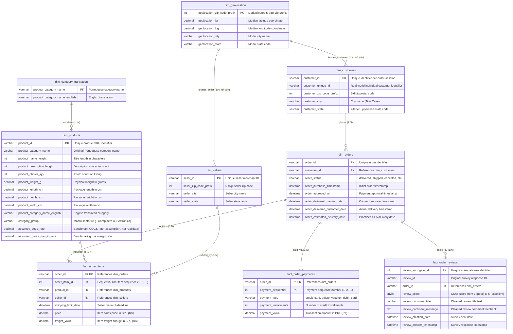

# Entity-Relationship (ER) Diagram & Relational Schema Design

This document details the relational data architecture designed for the **Olist Brazilian E-Commerce Analytics Platform**.

---

## 1. Relational ER Diagram

---

## 2. Schema Architecture & Design Justification

1. **Star / Snowflake Hybrid Schema**:
   * **Central Facts**: Transaction items (`fact_order_items`), installment settlements (`fact_order_payments`), and survey feedback (`fact_order_reviews`).
   * **Conformed Dimensions**: Orders header (`dim_orders`), Customers (`dim_customers`), Sellers (`dim_sellers`), Products (`dim_products`), and Postal Geography (`dim_geolocation`).
2. **Grain Specification**:
   * `fact_order_items`: One row per item SKU per order. Composite Primary Key: `(order_id, order_item_id)`.
   * `fact_order_payments`: One row per payment split per order. Composite Primary Key: `(order_id, payment_sequential)`.
   * `fact_order_reviews`: One row per customer feedback submission. Surrogate Primary Key: `review_surrogate_id`.
3. **Data Integrity & Referential Constraints**:
   * All child tables enforce `FOREIGN KEY ... ON DELETE RESTRICT ON UPDATE CASCADE` to prevent orphaned transactions.
   * All monetary attributes are typed as `DECIMAL(10, 2)` to eliminate floating-point arithmetic rounding errors common with `FLOAT` or `DOUBLE`.
