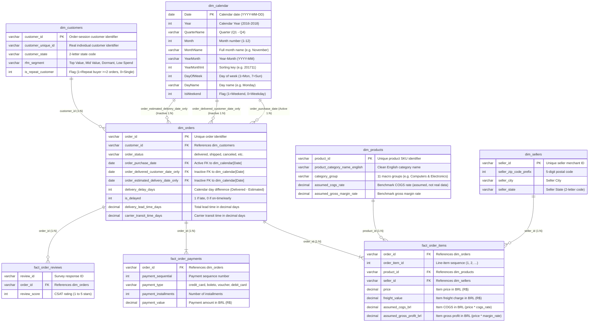

# Power BI Data Model Specification (Star Schema)

## 1. Executive Summary & Architecture Overview

The **E-Commerce Sales & Customer Intelligence Platform** data model is architected as an **enterprise Kimball-style Star Schema** optimized for high-performance analytical querying in Power BI Desktop (VertiPaq in-memory engine).

By decoupling dimensional entities (`dim_orders`, `dim_customers`, `dim_products`, `dim_sellers`, `dim_calendar`) from transactional fact tables (`fact_order_items`, `fact_order_payments`, `fact_order_reviews`), this schema eliminates circular dependencies, avoids bidirectional filtering pitfalls, and guarantees blazing-fast DAX measure evaluation.

> **Storage Mode**: **Import Mode** across all tables (optimized columnar compression).
> **Currency Standard**: **Brazilian Reais (R$ / BRL)**.
> **Date Master**: `dim_calendar` acts as the single source of truth for all time intelligence.

---

## 2. Star Schema Entity-Relationship Diagram

---

## 3. Data Dictionary & Table Inventory

| Table Name | Type | Granularity | Exact Rows | Primary Key | Description |
|:---|:---|:---|---:|:---|:---|
| **`dim_calendar`** | Dimension | 1 day | 1,096 | `Date` | Standard date master (2016-01-01 to 2018-12-31) |
| **`dim_orders`** | Dimension | 1 order | 99,441 | `order_id` | Order headers enriched with fulfillment SLA metrics |
| **`dim_customers`** | Dimension | 1 customer order key | 99,441 | `customer_id` | Customers enriched with RFM value segments |
| **`dim_products`** | Dimension | 1 product SKU | 32,951 | `product_id` | Product catalog with 11 macro categories & assumed margin rates |
| **`dim_sellers`** | Dimension | 1 merchant | 3,095 | `seller_id` | Merchant directory with geographical locations |
| **`fact_order_items`** | Fact | 1 order line item | 112,650 | Composite (`order_id`, `order_item_id`) | Sales merchandise revenue, freight, COGS, and GP |
| **`fact_order_payments`** | Fact | 1 payment transaction | 103,886 | Composite (`order_id`, `payment_sequential`) | Transaction amounts, payment methods, and installments |
| **`fact_order_reviews`** | Fact | 1 survey review | 99,224 | `review_id` / `order_id` | Customer CSAT survey ratings and response timestamps |

---

## 4. Relationship Cardinality & Cross-Filtering Configuration

All relationships in this data model follow strict **One-to-Many (`1:*`)** cardinality with **Single Cross-Filter Direction** flowing from Dimensions down to Fact tables:

| From Table (Dimension) | From Column (PK) | To Table (Fact / Dim) | To Column (FK) | Cardinality | Cross-Filter | Relationship State |
|:---|:---|:---|:---|:---:|:---:|:---:|
| `dim_calendar` | `Date` | `dim_orders` | `order_purchase_date` | `1:*` | Single (`dim_calendar` $\rightarrow$ `dim_orders`) | **Active** |
| `dim_calendar` | `Date` | `dim_orders` | `order_delivered_customer_date_only` | `1:*` | Single (`dim_calendar` $\rightarrow$ `dim_orders`) | **Inactive** *(Use via `USERELATIONSHIP` in DAX)* |
| `dim_calendar` | `Date` | `dim_orders` | `order_estimated_delivery_date_only` | `1:*` | Single (`dim_calendar` $\rightarrow$ `dim_orders`) | **Inactive** *(Use via `USERELATIONSHIP` in DAX)* |
| `dim_customers` | `customer_id` | `dim_orders` | `customer_id` | `1:*` | Single (`dim_customers` $\rightarrow$ `dim_orders`) | **Active** |
| `dim_orders` | `order_id` | `fact_order_items` | `order_id` | `1:*` | Single (`dim_orders` $\rightarrow$ `fact_order_items`) | **Active** |
| `dim_orders` | `order_id` | `fact_order_payments` | `order_id` | `1:*` | Single (`dim_orders` $\rightarrow$ `fact_order_payments`) | **Active** |
| `dim_orders` | `order_id` | `fact_order_reviews` | `order_id` | `1:*` | Single (`dim_orders` $\rightarrow$ `fact_order_reviews`) | **Active** |
| `dim_products` | `product_id` | `fact_order_items` | `product_id` | `1:*` | Single (`dim_products` $\rightarrow$ `fact_order_items`) | **Active** |
| `dim_sellers` | `seller_id` | `fact_order_items` | `seller_id` | `1:*` | Single (`dim_sellers` $\rightarrow$ `fact_order_items`) | **Active** |

---

## 5. Modeling Best Practices & Enterprise Standards

1. **Strict Star Schema Topology**:
   - Fact tables never filter other fact tables directly.
   - Slicing and filtering are executed through dimension tables (`dim_calendar`, `dim_products`, `dim_customers`, `dim_sellers`, `dim_orders`).
2. **Role-Playing Date Relationships**:
   - The primary active relationship between `dim_calendar[Date]` and `dim_orders[order_purchase_date]` ensures standard sales time intelligence (e.g. Month-over-Month, YTD).
   - Inactive relationships are leveraged via DAX `USERELATIONSHIP(dim_calendar[Date], dim_orders[order_delivered_customer_date_only])` when analyzing delivery fulfillment volume by delivery month.
3. **Dedicated Measures Table**:
   - All DAX measures are consolidated in a disconnected, empty table named `_Measures` organized into numbered display folders for clean report authoring.
4. **Column Formatting**:
   - All currency fields are formatted as `R$ #,##0.00; -R$ #,##0.00; "R$ 0.00"`.
   - Percentage fields are formatted as `0.00%`.
   - Integer counts are formatted as `#,##0`.
